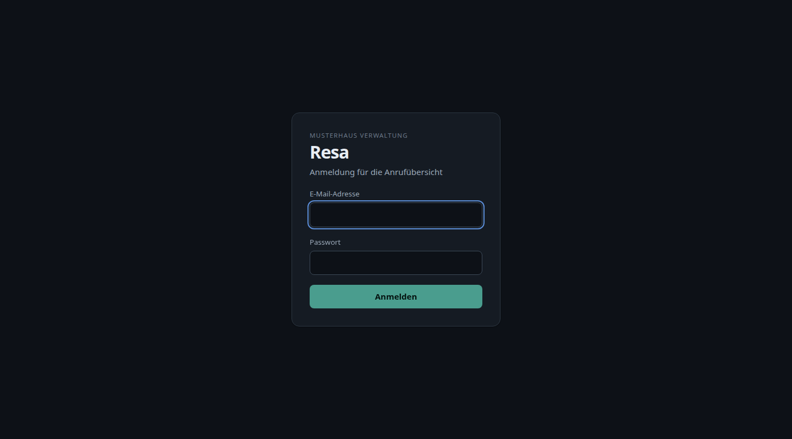
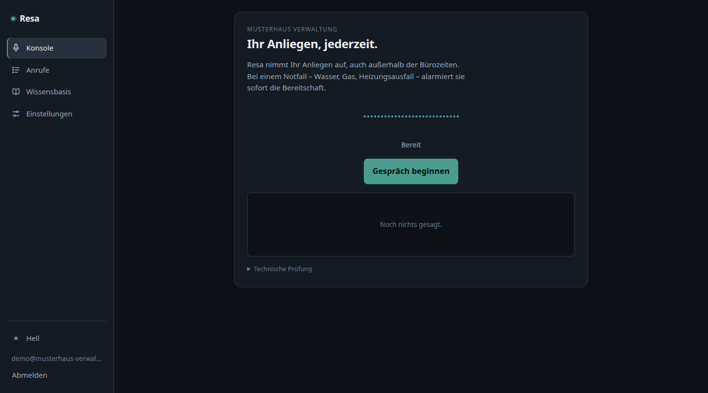
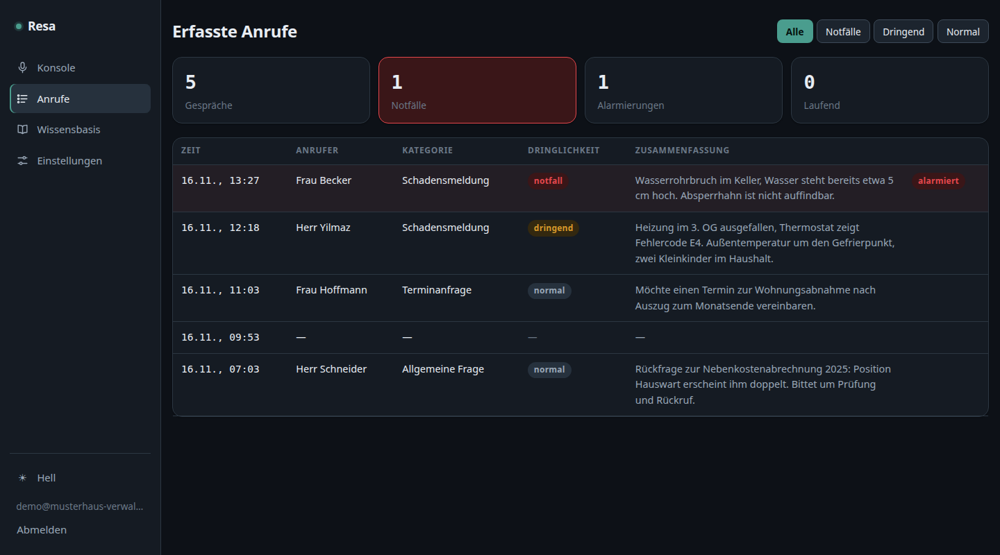
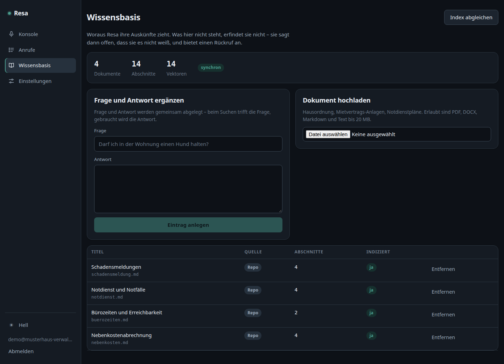
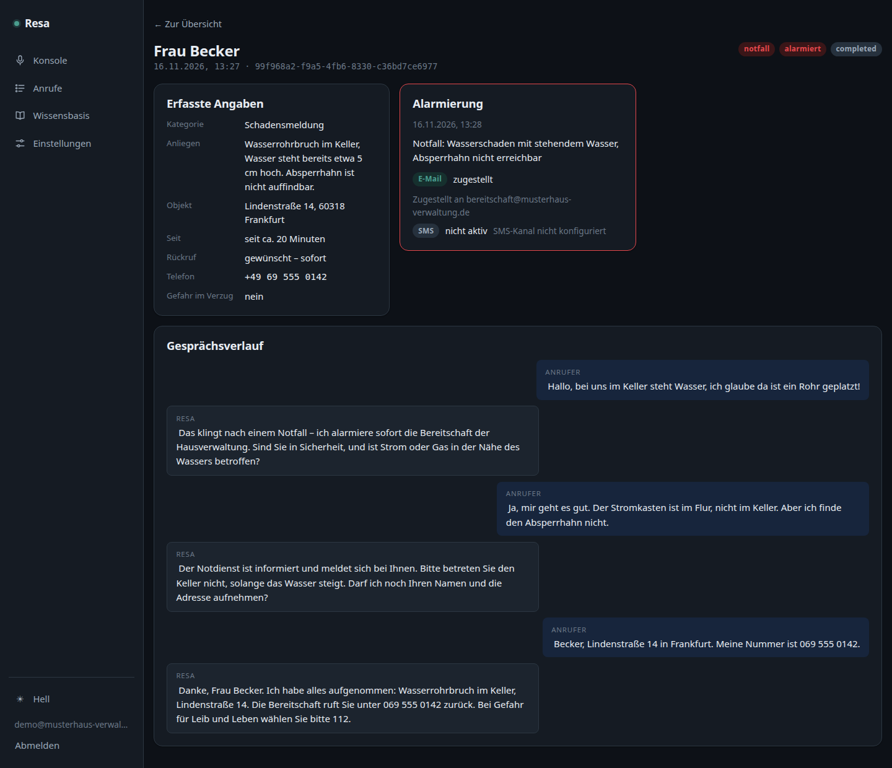

<div align="center">

# Resa

**An AI voice assistant for property management companies** — it takes the call, recognises an
emergency, alerts the on-call technician *before* it even asks for a name, records the case in a
structured way and shows it on a live dashboard while the conversation is still running.


</div>

---

## About

Someone calls to report a burst pipe. Resa recognises the emergency, **alerts the on-call team
immediately**, takes the case in a structured form and writes it to the dashboard, where it
appears while the call is still in progress.

It is a reference project: deliberately small, but with no shortcuts in the places that hurt in
real systems — consistency between two data stores, honest failure reporting, and latency you can
actually hear.

The assistant and the interface speak **German**, because the target users do. Identifiers, code
structure and this documentation are in English.

> **About the screenshots.** They were taken from a locally running stack filled with **seeded
> demo data** — invented people, addresses and phone numbers. The conversations shown were
> written directly to the database; no live Claude or ElevenLabs calls were made for them.

## Screenshots

|  |  |
|:--:|:--:|
|  |  |
| **Login** | **Konsole** — the voice console where a caller talks to Resa |
|  |  |
| **Anrufe** — captured calls with category, urgency and escalation state | **Wissensbasis** — what Resa may answer from; what is not in here, she does not invent |

<div align="center">

<br><em><strong>Emergency</strong> — structured intake, the escalation with per-channel delivery status, and the full transcript</em>
</div>

## What it demonstrates

- **Claude Opus 5** with tool use, streaming and prompt caching
- **RAG on Qdrant** — answers come from the knowledge base, not from the prompt
- **Local embeddings** via Ollama (`bge-m3`) — no per-call cost, no data leaves the machine
- **PostgreSQL as source of truth**, with the **outbox pattern** keeping Qdrant in sync
- **ElevenLabs** text-to-speech, streamed sentence by sentence and cached
- **Vue 3** dashboard with live updates over server-sent events
- **FastAPI** with authentication, a WebSocket channel and Alembic migrations

## Architecture

```
Browser                                    Backend
  SpeechRecognition ──→ text ──→ WS ──→ ConversationService
                                              │
                                              ├──→ Claude (Opus 5, streaming)
                                              ├──→ Qdrant (vector search)
                                              └──→ ElevenLabs (sentence by sentence)
  audio playback    ←── MP3  ←── WS ←─────────┘

Postgres ── source of truth: conversations, documents, chunks, outbox
Qdrant   ── derived data: vectors + search metadata
Ollama   ── bge-m3, produces the embeddings
```

`ConversationService` knows neither the browser nor speech output: text in, text out. Everything
channel-specific lives in an adapter, so telephony would be a second adapter, not a rewrite.

## Design decisions backed by measurements

**The retrieval similarity threshold is 0.30, not 0.45.** Measured on real questions: "What are
your office hours?" scores 0.68, while the colloquial "When are you open?" scores only 0.362 —
against the same, correct document. bge-m3 ranks reliably, but absolute scores depend heavily on
phrasing. A threshold of 0.45 would have left the most common question unanswered. The cut-off
now only removes obvious noise; weak matches are flagged as such, and the model that reads the
text judges whether it is usable.

**Filler announcements when a tool call starts.** A turn with a tool call needs two model calls,
and the first one yields no text — in an emergency that would be five seconds of silence. A short,
cached announcement bridges the gap. It is triggered on the tool call's `content_block_start`,
not when the model call ends, which is the difference between 3.3 s and 1.2 s to the first sound.

| | time to first sound |
|---|---|
| no bridging | 5403 ms |
| announcement on tool start | 3623 ms |
| … served from cache | 3321 ms |
| tool call detected early in the stream | **1208 ms** |

**Thinking stays on, `effort` is `low`.** Measured 1066 ms to first text against 1551 ms at
`medium`. Turning thinking off would be the wrong lever: without it the model occasionally writes
tool calls as visible text, and the call never executes.

**Alerting reports what was actually delivered.** Resa only says "the emergency service has been
informed" on confirmed delivery; otherwise she states the failure openly and points to 112. A
claimed alert that never arrived would be worse than none.

## Tech stack

| | |
|---|---|
| Backend | Python 3.13 · FastAPI · SQLAlchemy 2 (async) · Alembic · Pydantic |
| AI | Anthropic API (Claude Opus 5) · ElevenLabs TTS · Ollama `bge-m3` embeddings |
| Data | PostgreSQL 17 · Qdrant 1.19 |
| Frontend | Vue 3.5 · Vite · Pinia · Vue Router · TypeScript |
| Infra | Docker Compose · Caddy (automatic TLS, security headers, CSP) · Mailpit for local mail |
| Quality | pytest (39 tests, own test database) · ruff · `vue-tsc` |

## Running it

Requires Docker, an Ollama instance with `bge-m3` (or the bundled Compose profile, see below)
and API keys for Anthropic and ElevenLabs.

```bash
cp .env.example .env
# set ANTHROPIC_API_KEY and ELEVENLABS_API_KEY,
# point OLLAMA_BASE_URL at your own instance
perl -pi -e "s|^SECRET_KEY=.*|SECRET_KEY=$(openssl rand -hex 32)|" .env

docker compose up -d
docker compose exec api alembic upgrade head

# Check before indexing anything — the vector size can only be changed by re-indexing
docker compose exec api python -m app.cli embed-check

docker compose exec api python -m app.cli reindex
docker compose exec api python -m app.cli create-user you@example.com
docker compose exec api python -m app.cli set-oncall "Name" oncall@example.com

cd frontend && npm install && npm run build
```

Then open **https://localhost** (Caddy issues its own certificate, so a browser warning is
expected). Alert e-mails arrive in Mailpit at **http://localhost:8025**.

For frontend work use `npm run dev` instead — it runs on `localhost`, which is the secure context
the browser's speech recognition requires.

### Without your own Ollama instance

```bash
docker compose --profile local-embeddings up -d
docker compose exec ollama ollama pull bge-m3
# in .env: OLLAMA_BASE_URL=http://ollama:11434
```

### Operations

```bash
docker compose exec api python -m app.cli embed-check    # embedding service and dimension
docker compose exec api python -m app.cli reindex        # ingest the knowledge directory
docker compose exec api python -m app.cli repair-index   # reconcile Postgres against Qdrant
docker compose exec api python -m app.cli status         # count documents and vectors
docker compose exec api python -m app.cli search "..."   # query the knowledge base
docker compose exec api python -m app.cli say "..."      # check speech output
```

## Tests

```bash
docker compose exec api python -m pytest tests/ -q       # 39 tests, own test database
docker compose exec api python tools/ws_probe.py         # end-to-end probe over the WebSocket
cd frontend && npm run typecheck
```

The most interesting test is the outage:

```bash
docker compose stop qdrant
docker compose exec api python -m app.cli reindex --fresh   # loses nothing
docker compose start qdrant
docker compose exec api python -m app.cli repair-index      # catches up
```

## Deliberately not included

- **Telephony.** Connecting a real phone number would be a second adapter next to
  `channel_web.py` — with a provider that offers a text-in/text-out pattern (Telnyx Conversation
  Relay, sipgate flow) their service would also take over speech recognition and synthesis.
- **SMS alerting.** The interface exists (`escalation/channels.py`), the implementation does not:
  German landline numbers generally cannot send SMS, and an alphanumeric sender may require
  registration.
- **Hybrid search.** Qdrant supports sparse vectors; through Ollama only the dense ones arrive.
- **Multiple workers.** The live stream is an in-process broadcaster. Once more than one worker
  runs, Postgres `LISTEN/NOTIFY` takes its place — the interface stays the same.

## License

Free to use as a portfolio and reference project.
